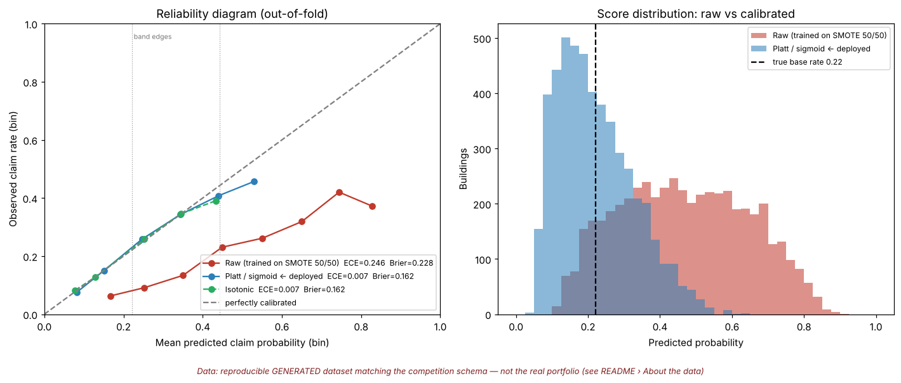
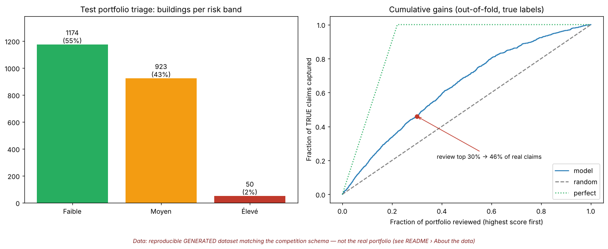

# 🏠 Insurance Claim-Risk Scorer

**An underwriting-triage system for building insurance.** It estimates a
*calibrated* probability that an insured building will file a claim, maps it to
a risk band with a recommended action, and serves it through a REST API and an
interactive app.

> [!IMPORTANT]
> **Data provenance.** All metrics in this repository are computed on a
> **reproducible generated dataset** that matches the competition schema, not
> on the real competition data, which is not redistributed here. The method
> transfers; the magnitudes are those of the generated data.
> See [About the data](#about-the-data) to re-run everything on the real CSVs.

<p align="left">
  
  
  
  
  
</p>

---

## The problem

At quote time, an insurer must decide how much scrutiny each building deserves.
Reviewing every policy by hand doesn't scale; reviewing none misprices risk.

The two errors are **not symmetric**:

| Error | Consequence |
|---|---|
| Missing a building that later claims | Under-pricing, under-reserving: a direct loss |
| Flagging a safe building | An analyst spends a few minutes |

So the objective is not accuracy (predicting "no claim" for everyone is right
about four times in five, and useless). It is **high recall on claims at a
deliberately chosen operating point, with probabilities that mean what they
say**, packaged as a decision the business can act on.

---

## Results

> **Metrics below are computed on the reproducible generated dataset, not the real competition data; see [About the data](#about-the-data).**
> All figures are **out-of-fold**: every one of the 5,012 training buildings is scored by a model that never saw it.

Champion: **logistic regression** (L2, C=0.1), calibrated with **Platt scaling**.

| Metric | Value |
|---|---|
| ROC-AUC (5-fold CV) | **0.673 ± 0.011** |
| Theoretical ceiling on this data (generator's own formula) | 0.690 |
| Recall on claims @ threshold 0.176 | **80.4%** |
| Precision @ threshold | 29.6% (base rate 22.1%) |
| Share of portfolio flagged for review | 60.0% |
| Top-30% review captures | **45.9%** of real claims (1.53× random) |
| Expected calibration error | 0.246 raw → **0.007** calibrated |

**The honest summary:** the signal in this data is weak, and the model gets
nearly all of it (within 0.02 AUC of the ceiling). Guaranteeing 80% claim
recall therefore means reviewing about 60% of the portfolio. The system makes
that trade-off explicit instead of hiding it behind a single score.

### 1. A leakage study that corrected the headline numbers

The first version of this project reported **AUC ≈ 0.81–0.83**. That number
was not real. The `Geo_Code` target encoding (claim rate per zone) was fitted
on all training rows *before* the train/validation split, so each validation
building's feature contained its own label.

Because the data is generated, there is a hard ceiling: the generator's own
noise-free risk formula. Under identical 5-fold CV (`diagnostics.py`):

| Setup | CV AUC |
|---|---|
| Geo map fitted on all rows (own label leaks), *v1* | 0.826 |
| **Fold-safe + out-of-fold Geo encoding, *current*** | **0.673** |
| Fold-safe, Geo features removed entirely | 0.674 |
| **Ceiling:** the generator's true formula, without noise | **0.690** |

The v1 pipeline scored **above the theoretical ceiling**, which is impossible
without leakage. Fitted honestly, Geo adds nothing: with about 4.5 buildings
per zone, the smoothed encoding (correctly) shrinks almost every zone back to
the global rate. Tests now require the reported AUC to stay below the ceiling.

### 2. Probability calibration

SMOTE trains the model on a 50/50 class mix, so its raw scores describe a world
where half of buildings claim. On this portfolio a raw score averages **0.467**
against a true claim rate of **0.221**: risk is overstated about 2×.

Two calibrators were fitted on out-of-fold scores and evaluated **cross-fitted**
(each fold calibrated by a map learned on the other folds). The deployed one is
the one with lower held-out log-loss:

| Scores | Log-loss | Brier | ECE | Mean predicted |
|---|---|---|---|---|
| Raw (SMOTE-trained) | 0.647 | 0.228 | 0.246 | 0.467 |
| Isotonic regression | 0.502 | 0.162 | 0.007 | 0.221 |
| **Platt / sigmoid — deployed** | **0.497** | **0.162** | **0.007** | **0.221** |



Platt wins narrowly and, unlike isotonic regression, has no step artefacts in
the sparse high-risk tail. It is also the natural fit here: SMOTE's distortion
is mostly a prior shift in logit space, which is exactly what Platt corrects.

### 3. Triage policy on calibrated probabilities

Bands are defined **relative to the portfolio's own claim rate**, so they keep
their meaning if the data changes. Each row shows the **observed** claim rate of
the buildings placed in that band (out-of-fold):

| Band | Calibrated probability | Share | Predicted | **Observed** | Observed vs average | Action |
|---|---|---|---|---|---|---|
| 🟢 **Faible** | < 0.221 (below average) | 55.8% | 0.144 | **0.145** | 0.66× | Auto-approve / fast-track |
| 🟠 **Moyen** | 0.221 – 0.442 (1–2×) | 41.0% | 0.305 | **0.311** | 1.41× | Standard manual review |
| 🔴 **Élevé** | ≥ 0.442 (> 2×) | 3.2% | 0.490 | **0.399** | 1.80× | Senior underwriter + inspection |

Observed risk rises monotonically across bands, and the two bands holding 97%
of buildings are calibrated to within 0.01. **Limitation:** the Élevé band is
narrow and somewhat over-predicted (0.49 predicted vs 0.40 observed on 158
buildings). On a signal this weak, few buildings can be confidently placed at
twice the average risk. A small escalation queue suits a scarce resource like
senior underwriters, but its probabilities should be read as "high, likely
overstated".

On the 2,147-building test portfolio: **1,174 Faible · 923 Moyen · 50 Élevé**.

### 4. The operating point is a business lever

The threshold maximises F1 **subject to recall ≥ 70%** on claims. Moving it
changes how much review effort buys how much claim capture. That's the choice
an underwriting manager actually makes:



### 5. Model comparison (held-out 20% split, raw scores @ 0.5)

| Model | F1 | ROC-AUC | Recall |
|---|---|---|---|
| **Logistic Regression** 🏆 | **0.437** | **0.688** | **0.658** |
| K-NN (k=7) | 0.379 | 0.601 | 0.505 |
| Decision Tree | 0.292 | 0.536 | 0.320 |
| LightGBM | 0.216 | 0.615 | 0.144 |
| XGBoost (tuned) | 0.205 | 0.598 | 0.158 |
| Random Forest (tuned) | 0.203 | 0.640 | 0.135 |
| Gradient Boosting | 0.169 | 0.659 | 0.104 |
| Voting Ensemble | 0.151 | 0.666 | 0.086 |

**Why the linear model wins.** Once the leak is removed, the signal is weak and
close to additive. That's how the generator built it, and it's a common shape
in tabular insurance data too. Tree ensembles have no interactions to discover,
so their extra capacity goes into fitting SMOTE's synthetic minority points.
Their AUC stays competitive, but their raw scores at 0.5 recover few claims.
Regularised logistic regression generalises best and remains auditable: each
coefficient is a risk driver an underwriter can read and contest.

---

## Quickstart

```bash
pip install -r requirements.txt

python train.py                               # trains, evaluates, calibrates; writes models/ + predictions
uvicorn api.main:app --reload --port 8000     # REST API -> http://localhost:8000/docs
streamlit run app/streamlit_app.py            # interactive app
pytest -q                                     # full test suite
```

Or with Docker (trains at build time and ships a ready model):

```bash
docker build -t claim-risk-api .
docker run -p 8000:8000 claim-risk-api
```

### Scoring a building

```bash
curl -X POST http://localhost:8000/predict -H "Content-Type: application/json" -d '{
  "YearOfObservation": 2014, "Insured_Period": 0.5, "Residential": 1,
  "Building_Painted": "N", "Building_Fenced": "N", "Garden": "O",
  "Settlement": "R", "Building Dimension": 8000, "Building_Type": "Wood-framed",
  "NumberOfWindows": "without", "Geo_Code": "0042"
}'
```

`Building Dimension`, `Garden` and `Geo_Code` may be `null`; they are imputed
exactly as in training.

| Endpoint | Purpose |
|---|---|
| `GET /health` | Liveness, champion, **data source**, calibration method, threshold, band edges |
| `GET /schema` | Accepted features, categorical levels, risk-band ranges |
| `POST /predict` | Score one building |
| `POST /predict/batch` | Score many + portfolio summary |

---

## How it works

```
data/make_dataset.py     Dataset resolution + provenance fingerprint (generated vs real)
src_pipeline.py          Single source of truth: preprocessing, leakage-safe encoding,
                         training, calibration, thresholds, TrainedModel.score_frame
diagnostics.py           Leakage study (leaky vs fold-safe vs theoretical ceiling)
train.py                 Runs everything; writes models/, figures, predictions
api/main.py              FastAPI service (typed Pydantic contracts)
app/streamlit_app.py     Score / batch upload / model card, with a data-source banner
notebooks/               Executed case study + the script that builds it
tests/                   Parity, calibration, provenance, leakage, API contract
```

**One scoring path.** `train.py`, the API, the Streamlit app and the notebook
all score through `TrainedModel.score_frame`. `tests/test_parity.py` sends all
2,147 test buildings through the live API and requires identical answers to
`train.py` and to the notebook, row by row.

That test was not hypothetical. In v1, Geo codes were float keys in memory and
string keys after the JSON save/load, so the **deployed API silently ignored
location and disagreed with the published predictions on 710 of 2,147
buildings**. Nothing compared the two paths. Now the suite does, along with
regression tests for the key canonicalisation and the JSON round-trip.

### Leakage controls (each one tested)

- Preprocessing statistics (imputation, P99 cap, Geo map) are learned from the
  training portion of every split only.
- Training rows get an **out-of-fold** Geo encoding: no building's feature
  contains its own label (tested with one-building-per-zone data, where any
  leak would reveal the label).
- SMOTE, scaling and preprocessing are refit inside every CV fold.
- Calibration is **cross-fitted**: a fold's calibrated scores don't change
  when that fold's labels are shuffled (tested).
- On generated data, the reported AUC must stay below the theoretical ceiling.

### Test suite

| File | What it guards |
|---|---|
| `test_parity.py` | API = `train.py` = notebook on all 2,147 buildings; single = batch; saved bundle = in-memory model; JSON round-trip; no side implementations |
| `test_calibration.py` | Mean prediction = claim rate; ECE/Brier/log-loss improve; monotone; deployed method = best held-out; bands rise monotonically; recall guarantee |
| `test_provenance.py` | Generated vs real detection; flag stored in the bundle, exposed by API/app/figures; README flag sits directly under *Results* |
| `test_pipeline.py` | Schema, imputation, out-of-fold encoding, AUC ≤ ceiling, API contract and validation |

---

## About the data

The task is the public **building-insurance claim prediction** challenge
(Data Science Nigeria / Zindi): 5,012 training and 2,147 test buildings
described by 11 features (observation year, coverage period, residential flag,
paint, fence, garden, settlement, dimension, building type, window count, geo
code), with a binary claim outcome and about 22% positives.

**What is in this repository.** The competition files are governed by their
host's terms and are not redistributed here. Instead `data/make_dataset.py`
generates a deterministic dataset that matches the real schema: column names
and types, categorical levels, class balance (≈78/22), missing-value rates
(Building Dimension ≈1.5%, Geo_Code ≈1.5%, Garden <0.1%), Geo_Code cardinality
(~1,100 zones) and dimension outliers. Labels come from a transparent risk
formula plus noise (`true_risk_logit`), which is what makes the theoretical
ceiling in the leakage study possible.

**How provenance is tracked.** When the generator writes the CSVs it also
writes `data/GENERATED_DATA.sha256`. If the training file still matches that
fingerprint, the run is labelled `generated`; any other file is labelled `real`.
The label is stored in `models/metadata.json` and shown by `/health`, the
Streamlit banner, the notebook header and a footer on every figure.

**Running on the real data.** Place the original `train_Insurance.csv` and
`test_Insurance.csv` in `data/`, then:

```bash
python train.py && pytest -q
```

Everything (training, calibration, bands, figures, API, app) re-runs unchanged
and is labelled `real`. The leakage ceiling is skipped, since it only exists
for generated data. Update the numbers in this README from
`models/metadata.json` before quoting them.

---

## What changed from v1

| v1 | Now |
|---|---|
| Geo target encoding fitted before the split (label leakage) | Fold-safe, out-of-fold encoding; AUC tested against a theoretical ceiling |
| Reported AUC ≈ 0.81, F1 ≈ 0.55 | AUC 0.673, F1 0.433 out-of-fold; v1 figures were inflated by the leak |
| API disagreed with published predictions on 710/2,147 buildings | Identical on all 2,147, enforced by tests |
| API rejected buildings with missing values | Nulls accepted and imputed as in training |
| Uncalibrated SMOTE scores; fixed 0.30/0.60 bands | Cross-fitted Platt calibration (ECE 0.246 → 0.007); bands relative to claim rate with observed rates |
| Data provenance noted at the bottom of the README | Flag at the top, under *Results*, in the API, app, notebook and every figure, all tested |

---

## Roadmap

- **Cost-sensitive thresholding.** With claim severity data, minimise expected
  monetary loss instead of maximising F1 under a recall constraint.
- **Hierarchical Geo encoding** (zone → region) or external geographic data:
  the zone-level encoding is too sparse to carry signal.
- **Calibration monitoring** in production: track observed vs predicted rate
  per band and re-fit the calibrator when they drift.
- **Cloud deployment** of the Docker image with load testing of `/predict/batch`.
